# Praktikum CRUD Data Barang (PHP & MySQL)

Aplikasi web sederhana untuk mengelola **Data Barang** menggunakan PHP Native dan MySQL (MySQLi). Fitur yang dibuat: menampilkan data (Read), menambah data (Create), mengubah data (Update), dan menghapus data (Delete), termasuk upload gambar barang.

## Struktur Folder

```
latihan1/
├── gambar/        # folder tempat menyimpan gambar yang diupload
├── koneksi.php    # koneksi ke database
├── index.php      # menampilkan data barang
├── tambah.php     # form & proses tambah barang
├── ubah.php       # form & proses ubah barang
├── hapus.php      # proses hapus barang     
└── README.md
```

## Langkah 1 – Persiapan Lingkungan

1. Jalankan **XAMPP**, lalu aktifkan modul **Apache** dan **MySQL**.
2. Letakkan folder proyek di dalam `C:\xampp\htdocs\` (misalnya `htdocs/latihan1`).
3. Buat folder `gambar` di dalam folder proyek untuk menyimpan file upload.

**Screenshot:**

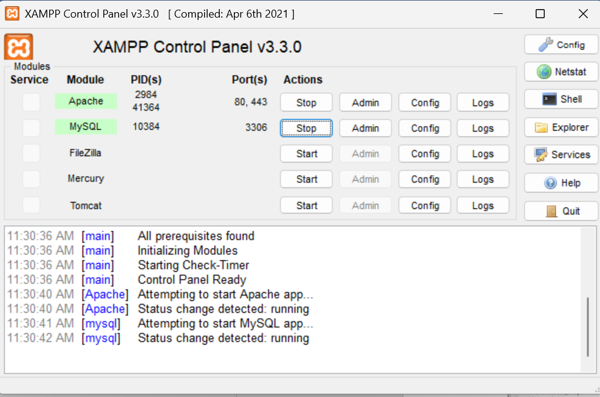

## Langkah 2 – Membuat Database dan Tabel

Buka `http://localhost/phpmyadmin`, buat database bernama **latihan1**, lalu jalankan query berikut untuk membuat tabel `data_barang`:

```sql
CREATE TABLE data_barang (
    id_barang  INT AUTO_INCREMENT PRIMARY KEY,
    nama       VARCHAR(100) NOT NULL,
    kategori   VARCHAR(50),
    harga_jual INT,
    harga_beli INT,
    stok       INT,
    gambar     VARCHAR(255)
);
```

Penjelasan kolom:

| Kolom | Keterangan |
|-------|-----------|
| `id_barang` | Primary key, otomatis bertambah |
| `nama` | Nama barang |
| `kategori` | Komputer / Elektronik / Hand Phone |
| `harga_jual` | Harga jual barang |
| `harga_beli` | Harga beli barang |
| `stok` | Jumlah stok |
| `gambar` | Nama/path file gambar barang |

**Screenshot:**

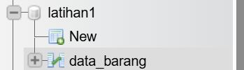
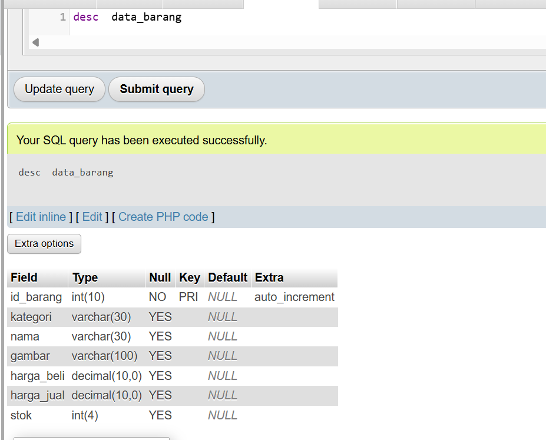

## Langkah 3 – Membuat File Koneksi (`koneksi.php`)

File ini menghubungkan PHP dengan MySQL menggunakan `mysqli_connect()`. Parameter yang dipakai: host `localhost`, user `root`, password kosong, dan database `latihan1`. Jika koneksi gagal, program menampilkan pesan error lalu berhenti (`die()`).

```php
$conn = mysqli_connect($host, $user, $pass, $db);
```

File ini di-*include* oleh semua halaman lain agar variabel `$conn` dapat dipakai.

**Screenshot:**

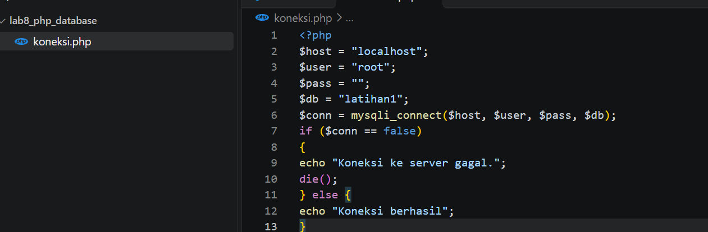 
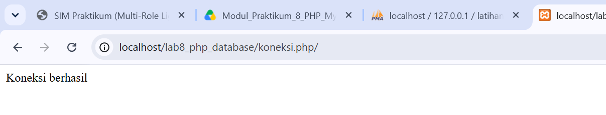

## Langkah 4 – Menampilkan Data (`index.php`)

1. Memanggil `koneksi.php` dengan `include`.
2. Menjalankan query `SELECT * FROM data_barang`.
3. Menampilkan hasil dalam tabel HTML menggunakan perulangan `while` dengan `mysqli_fetch_array()`.
4. Kolom yang ditampilkan: Gambar, Nama Barang, Kategori, Harga Jual, Harga Beli, Stok, dan Aksi.
5. Kolom Aksi berisi link **Ubah** (`ubah.php?id=...`) dan **Hapus** (`hapus.php?id=...`) dengan konfirmasi JavaScript `confirm()`.
6. Jika data kosong, tampil teks "Belum ada data".

**Screenshot:**

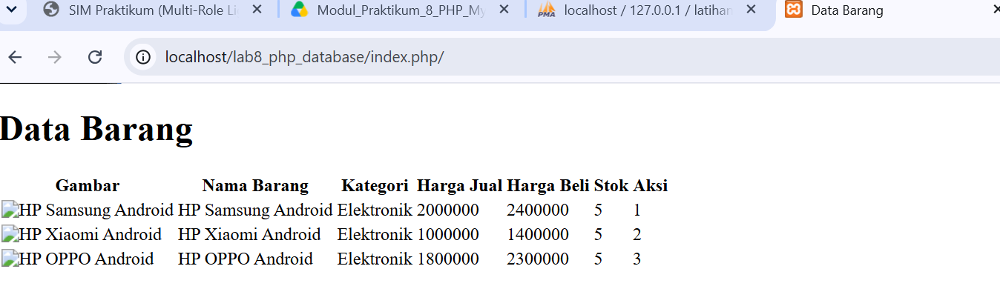

## Langkah 5 – Menambah Data (`tambah.php`)

1. Form berisi input Nama Barang, Kategori (dropdown), Harga Jual, Harga Beli, Stok, dan File Gambar. Form memakai `method="post"` dan `enctype="multipart/form-data"` agar bisa mengirim file.
2. Saat tombol **Simpan** ditekan (`isset($_POST['submit'])`), data diambil dari `$_POST` dan file dari `$_FILES`.
3. Jika file berhasil diupload (`error == 0`), spasi pada nama file diganti `_`, lalu file dipindahkan ke folder `gambar/` dengan `move_uploaded_file()`.
4. Data disimpan ke database dengan query `INSERT INTO data_barang ...`.
5. Setelah itu halaman diarahkan kembali ke `index.php` dengan `header('location: index.php')`.

**Screenshot:**

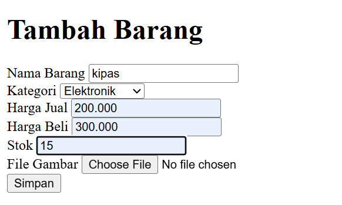


## Langkah 6 – Mengubah Data (`ubah.php`)

1. Halaman menerima parameter `id` dari URL (`ubah.php?id=...`), lalu mengambil data barang dengan `SELECT ... WHERE id_barang = ...`.
2. Data lama ditampilkan pada form. Untuk dropdown kategori, fungsi `is_select()` menandai pilihan yang sesuai dengan atribut `selected`.
3. Id barang dikirim lewat input `hidden`.
4. Saat **Simpan** ditekan, query `UPDATE data_barang SET ... WHERE id_barang = ...` dijalankan.
5. Kolom `gambar` hanya diperbarui jika pengguna memilih file gambar baru.
6. Setelah selesai, halaman kembali ke `index.php`.

**Screenshot:**

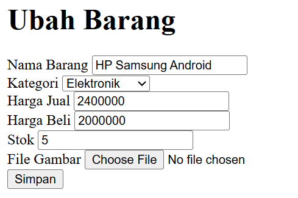
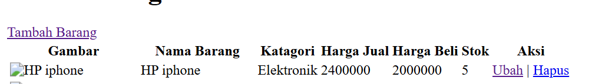

## Langkah 7 – Menghapus Data (`hapus.php`)

1. Mengambil `id` dari URL (`$_GET['id']`).
2. Menjalankan query `DELETE FROM data_barang WHERE id_barang = ...`.
3. Mengarahkan kembali ke `index.php`.
4. Sebelum dihapus, muncul kotak konfirmasi "Yakin ingin menghapus data?" dari `index.php`.

**Screenshot:**

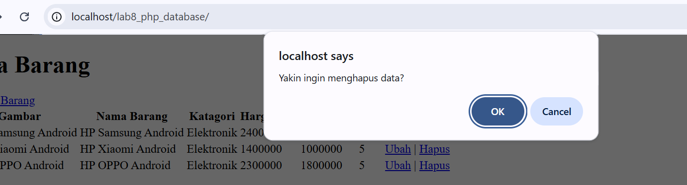
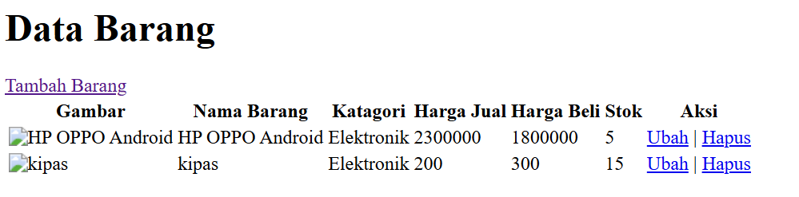

## Langkah 8 – Menjalankan Aplikasi

Buka browser dan akses:

```
http://localhost/lab8_php_database/index.php
```

**Screenshot:**

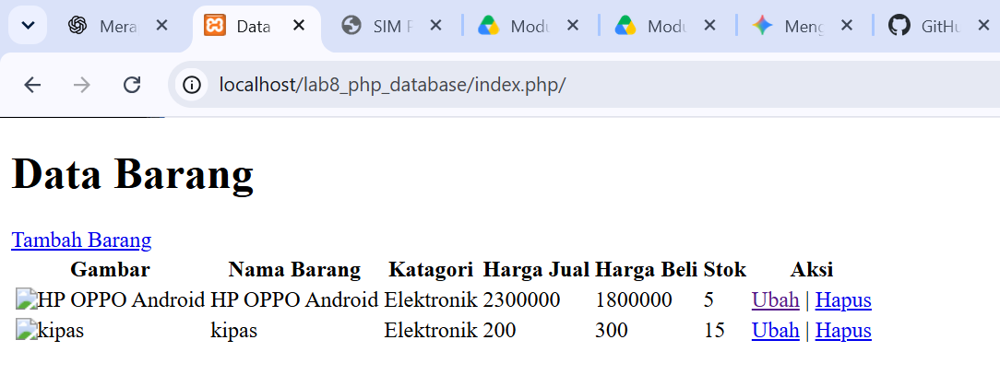

## Catatan

- Query pada praktikum ini masih menyisipkan input langsung ke SQL sehingga rentan **SQL Injection**. Untuk aplikasi nyata, gunakan *prepared statement* (`mysqli_prepare`) atau `mysqli_real_escape_string()`.
- Upload file sebaiknya divalidasi (ekstensi dan ukuran) agar aman.
- Pada `tambah.php` dan `ubah.php`, kolom `gambar` disimpan dengan awalan `gambar/`, sedangkan `index.php` menambahkan lagi `gambar/` saat menampilkan gambar. Jika gambar tidak muncul, hapus salah satu awalan tersebut agar path menjadi `gambar/namafile.jpg`.
